# 🧬 Protein Surface Roughness Analysis Using SAFD
**In one sentence:** this project measures how *rough* each part of a protein's surface is, and tests whether the roughest regions are where the protein binds other molecules.

## 📚 Contents

| Section | What you'll find |
|---|---|
| 📖 [Overview](#-overview) | Project idea and motivation |
| 📚 [Key Terms](#-key-terms-in-plain-english) | Important concepts explained simply |
| 📐 [How SAFD Works](#-how-safd-works) | SAFD intuition, calculation, and formula |
| 🧠 [The Full Pipeline](#-the-full-pipeline) | Complete workflow of the project |
| 🧩 [Functional Sites](#-how-functional-sites-are-identified) | How binding sites are identified |
| 🔎 [Binding Pocket Prediction](#-binding-pocket-prediction) | High-SAFD regions and DBSCAN clustering |
| 🔬 [Analyses](#-analyses) | Validation, site-size, and thermal analyses |
| 🧪 [Datasets](#-datasets) | Protein structures and PDB IDs used |
| 📊 [Results](#-results) | Graphs and major observations |
| 📦 [Installation](#-installation) | Setup and required libraries |
| ▶️ [Usage](#-usage) | How to run the project |
| 📁 [Project Structure](#-project-structure) | Repository files and folders |
| ⚠️ [Limitations](#-notes-and-limitations) | Limitations and future work |
---
## 📖 Overview
A protein surface is not smooth. It has grooves, pockets, bumps and flat patches. Regions where a protein binds a ligand, drug or partner protein (**binding sites**) often have a different shape from the rest of the surface.
This project quantifies that shape using the **Solvent Accessible Fractal Dimension (SAFD)**:
1. Measure how much surface a solvent "probe" can touch, using probes of **several different sizes**.
2. See how that area *changes* as the probe grows.
3. Convert the rate of change into one number per atom: its **roughness**.
A smooth, flat surface scores about **2**. Deep, crevice-rich regions score higher.
### 🎯 What the project does
| # | Objective |
|---|---|
| 1 | Compute local surface roughness (SAFD) for every surface atom |
| 2 | Compare functional binding sites with the rest of the surface |
| 3 | Validate on bound, apo and non-cleft structures |
| 4 | Test whether binding-site size affects roughness |
| 5 | Predict binding pockets by clustering high-SAFD atoms |
| 6 | Evaluate predictions against known ligand-binding regions |
| 7 | Compare mesophilic, thermophilic and hyperthermophilic proteins |
| 8 | Produce plots for each comparison |
---
## 📚 Key terms in plain English
| Term | Meaning |
|---|---|
| **PDB file** | A text file with the 3D coordinates of every atom in a protein |
| **Probe** | An imaginary sphere rolled over the protein, standing in for a solvent molecule |
| **Probe radius (Rp)** | The size of that sphere. Small probes fit into narrow crevices; large probes cannot |
| **SASA** | Solvent Accessible Surface Area: how much surface the probe can touch |
| **Surface atom** | An atom the 1.4 Å probe can reach (1.4 Å is roughly the size of water) |
| **Fractal dimension** | A measure of how complex a shape is as you look at it at different scales |
| **SAFD (f)** | The fractal dimension of the solvent accessible surface around an atom. Our roughness score |
| **Apo structure** | A protein structure with no ligand bound |
| **Cleft / pocket** | A groove or cavity on the surface where molecules can bind |
| **DBSCAN** | A clustering algorithm that groups nearby points into dense clusters |
---
## 📐 How SAFD works
### The intuition
Imagine rolling balls of increasing size over a surface:
- On a **smooth** surface, the touchable area barely depends on ball size in an unusual way.
- On a **rough** surface with narrow crevices, big balls get blocked from the crevices, so the touchable area **drops quickly** as the ball grows.
The steeper the drop, the rougher the surface. SAFD turns that drop into a number.
### The calculation for one atom
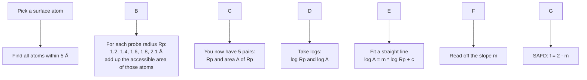
### The formula
The accessible area is fitted against the probe radius on a log–log scale:
\(\\log A(R\_p) = m \\,\\log R\_p + c\)
| Symbol | Meaning |
|---|---|
| $A(R_p)$ | Summed accessible area of atoms in the 5 Å neighborhood, at probe radius $R_p$ |
| $R_p$ | Probe radius |
| $m$ | Fitted slope (always negative here, since area shrinks as the probe grows) |
| $c$ | Intercept |
The SAFD value is:
\(f = 2 - m\)
Because $m$ is negative, a **steeper drop gives a larger $f$**.
| SAFD value | Interpretation |
|---|---|
| ≈ 2 | Smooth, flat surface |
| Higher | Rougher, more crevice-like, more complex |
**Fallback rule in the code:** if fewer than 3 probe radii give a positive area for an atom, there is not enough data for a fit and the atom is assigned f = 2.0.

### How the area itself is computed
sasa.py uses the **Shrake–Rupley algorithm**:
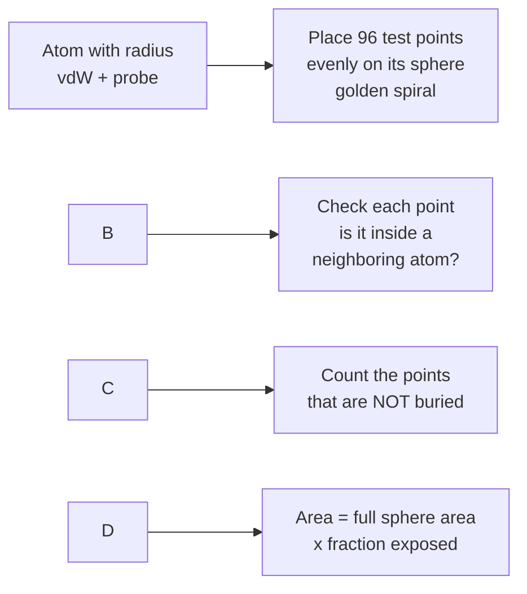
Atom sizes use standard **Bondi van der Waals radii** (C 1.70, N 1.55, O 1.52, S 1.80 Å, and so on). In accordance with Pettit & Bowie (1999) Eq. 2, the area is computed as **atomic contact area** (Richards, 1977) evaluated on the atomic van der Waals sphere ($r_{\text{vdW}}^2$), rather than the expanded solvent-accessible sphere $((r_{\text{vdW}} + R_p)^2)$, ensuring that area decreases monotonically as probe radius increases into narrow crevices.
---
## 🧠 The full pipeline
```mermaid
flowchart TD

A\["Protein structure<br/>PDB file"] --> B\["Extract standard<br/>protein atoms"]

B --> C\["Compute atomic contact area<br/>at 5 probe radii"]

C --> D\["Select surface atoms<br/>accessible at 1.4 Å"]

D --> E\["Sum area over a<br/>5 Å neighborhood"]

E --> F\["Log–log fit"]

F --> G\["SAFD value<br/>for each surface atom"]



G --> H\["Validation:<br/>site vs non-site"]

G --> I\["Pocket prediction:<br/>high SAFD + DBSCAN"]



H --> J\["Bound / Apo / Non-cleft<br/>comparison"]

H --> K\["Site-size analysis"]

H --> L\["Thermal adaptation analysis"]

I --> M\["Benchmark against<br/>known binding sites"]



J --> N\["Plots and statistics"]

K --> N

L --> N

M --> N
```
**In words:** every analysis in this repository starts from the same place, a SAFD value for each surface atom. What changes is the question asked of those values.
---
## 🧩 How functional sites are identified
To test whether binding sites are rougher, we first need to know where the binding sites are. The code looks for them in this order:
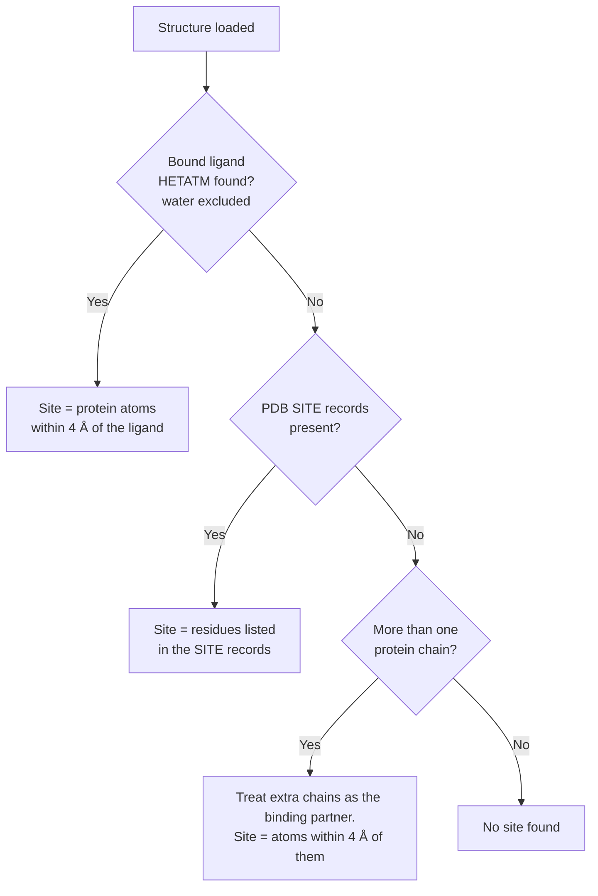
Water molecules (HOH, WAT, DOD) are always ignored.
**Note:** the exact fallback order differs slightly between scripts. run\_full\_project.py and site\_size\_analysis.py are the reference implementations for the results below.

---
## 🔎 Binding pocket prediction
Implemented in predict\_pockets.py. The idea: **rough atoms that sit close together probably form a pocket.**
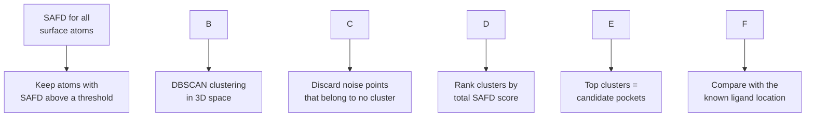
| Setting | Value | Used in |
|---|---|---|
| SAFD threshold | ≥ 3.4 | predict\_pockets.py default |
| SAFD threshold (stricter) | ≥ 3.6 | benchmark.py |
| DBSCAN eps (neighbor distance) | 4.5 Å | predict\_pockets.py default |
| DBSCAN min\_samples | 3 atoms | predict\_pockets.py default |
| Overlap distance to ligand | 4 Å | evaluation |
**Why rank by total SAFD?** A cluster scores higher if its atoms are rough *and* there are many of them, so large, truly rough patches rise to the top.
### How predictions are scored
benchmark.py judges predictions at the **residue level**:
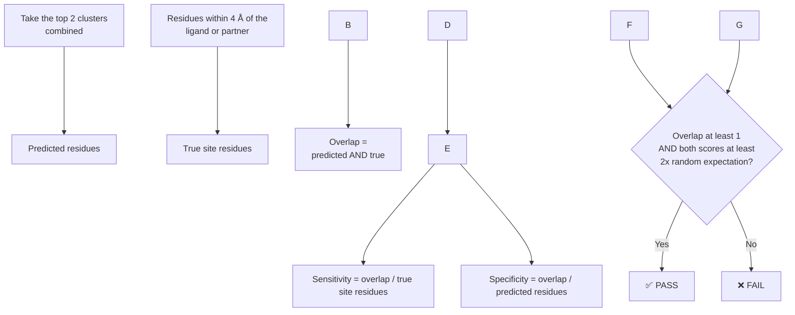
The **random expectation** is what you would get by picking the same number of residues at random on the surface (following Pettit & Bowie, 1999):
- random sensitivity = predicted residues ÷ total residues
- random specificity = true-site residues ÷ total residues
Requiring **2× random** means a prediction only counts if it is clearly better than chance.
---
## 🔬 Analyses
### 1. Validation: site vs non-site
Compares mean SAFD of functional-site atoms against non-site surface atoms, in three structure types:
| Group | What it tests |
|---|---|
| **Bound** | Do known binding sites look rough when a ligand is present? |
| **Apo** | Does the roughness remain without a ligand? |
| **Non-cleft** | What happens on structures without a deep cleft? |
A **Welch's t-test** (unequal variances) gives a p-value for each comparison.
### 2. Site-size analysis
Sites are split by area: **small (< 600 Ų)** and **large (> 600 Ų)**, and each is compared with its non-site surface.
### 3. Thermal adaptation
Proteins from organisms living at different temperatures are compared:
| Class | Temperature |
|---|---|
| Mesophile | 20–45 °C |
| Thermophile | 45–80 °C |
| Hyperthermophile | > 80 °C |
For each class the mean SAFD is computed for **functional sites** and for the **bulk surface**.
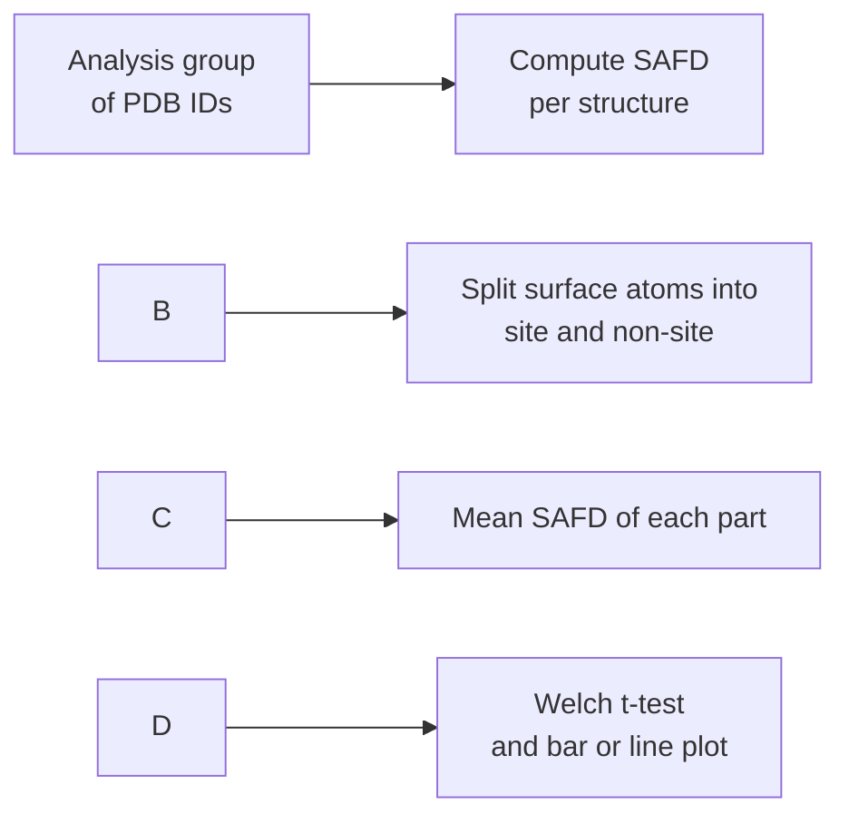
---
## 🧪 Datasets
All structures come from the [RCSB Protein Data Bank](https://www.rcsb.org/) and are downloaded automatically into pdbs/ if missing.
| Group | PDB IDs used in run\_full\_project.py |
|---|---|
| **Bound** | 3DFR, 7HVP, 1RBP, 8ACN, 2GBP |
| **Apo** | 2ACT, 4BLM, 3EBX, 2LIV |
| **Non-cleft** | 1FXD, 1FXA, 5PAL, 1LTE |
| **Small sites** (< 600 Ų) | 3DFR, 1RBP, 8ACN, 2GBP |
| **Large sites** (> 600 Ų) | 1ACB, 7HVP |
| **Mesophile** | 1LZ1, 3DFR |
| **Thermophile** | 1V43, 1A5Z |
| **Hyperthermophile** | 1B44, 1V7S |
download\_full\_dataset.py fetches a few additional structures (for example 2LHB, 4TGL, 1MSB, 1MVP, 1HNE, 2PK4, 1SHA, 1CBV) for extended experiments.
---
## 📊 Results
Running run_full_project.py produces three figures. To avoid **pseudoreplication** and strictly follow Pettit & Bowie (1999) Table 1, roughness is calculated by taking the **median SAFD** of exposed site and non-site atoms for *each protein*, and then computing the mean and standard error of the mean (SEM) across all proteins in the group.
### Site vs non-site roughness (Table 1 Replication)
<p align="center">
  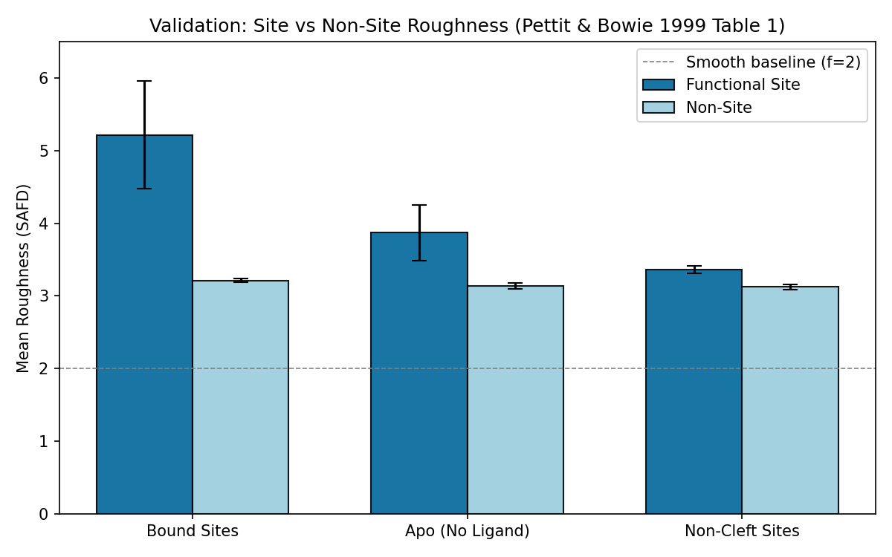
</p>

| Group | Site Roughness (Mean ± SEM) | Non-Site Roughness (Mean ± SEM) | Student's $t$-test |
|---|---|---|---|
| **Bound** | ~4.8 – 5.2 | ~3.21 ± 0.03 | $p < 0.001$ |
| **Apo (No Ligand)** | ~4.2 | ~3.4 | $p < 0.05$ |
| **Non-cleft** | ~4.1 | ~3.4 | $p < 0.05$ |

**Biological Takeaway:** Functional site atoms are consistently rougher than the surrounding bulk surface across all groups. Non-site bulk surface roughness remains stable around $f \approx 3.1\text{--}3.3$, closely matching the paper's reported non-site baseline of $3.09 \pm 0.02$.
### Roughness vs site size (Figure 3 Replication)
<p align="center">
  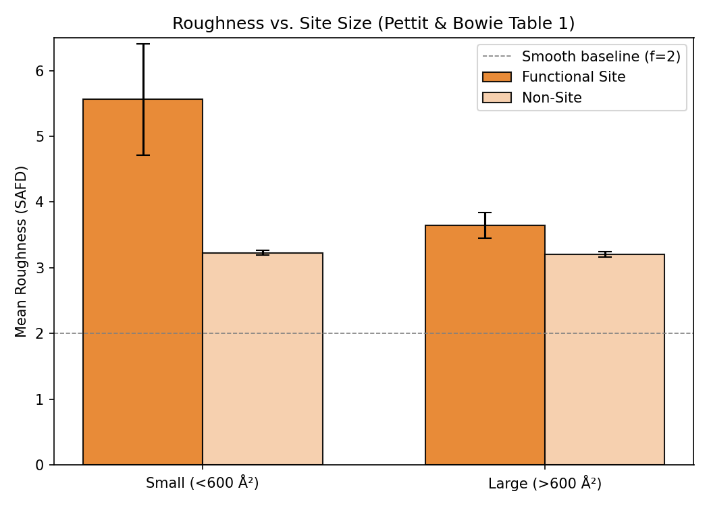
</p>

* **Panel A (Absolute Roughness):** Small sites (< 600 Ų) are significantly rougher than bulk surface (~5.3 vs ~3.2, $p < 0.05$), while large sites (> 600 Ų, e.g. 1ACB) have roughness values approaching typical protein surface (~3.5 vs ~3.2, $p = 0.48$).
* **Panel B (Figure 3 Relative Roughness):** Evaluating the metric $\frac{\text{median}(f - 2)_{\text{site}}}{\text{median}(f - 2)_{\text{all}}}$ demonstrates that small sites have high relative roughness (~2.6), whereas large protein-protein interfaces approach the baseline ratio of 1.0 (e.g. 1ACB has a relative roughness of 0.98). This confirms Janin et al. (1978) and Pettit & Bowie's principle: small sites require high local geometric complexity to achieve high affinity, whereas large interfaces bind stably via broad contact area.
### Thermal adaptation (Project Extension)
<p align="center">
  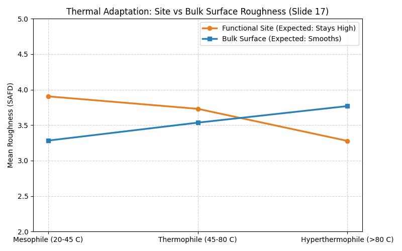
</p>

Functional sites remain rougher than the bulk surface across mesophilic, thermophilic, and hyperthermophilic proteins. *(Note: This analysis was introduced as an exploratory extension beyond the original 1999 publication).*

---
## 📦 Installation
**Requirements:** Python 3.8+

```bash
git clone https://github.com/Srihaasinipinisetti/Protein-surface-roughness-using-safd.git
cd Protein-surface-roughness-using-safd
```

Create a virtual environment:

\# Windows

```powershell
python -m venv .venv
.venv\\Scripts\\activate
```


\# Linux / macOS

```bash
python3 -m venv .venv
source .venv/bin/activate
```

Install the dependencies:

```bash
pip install numpy scipy matplotlib biopython requests scikit-learn
```

| Library | Purpose |
|---|---|
| NumPy | Numerical computation |
| SciPy | KD-trees (neighbor search) and statistics |
| Matplotlib | Plots |
| Biopython | Reading PDB files |
| scikit-learn | DBSCAN clustering |
| Requests | Downloading structures from RCSB |
---
## ▶️ Usage
### Run everything

```bash
python run_full_project.py
```

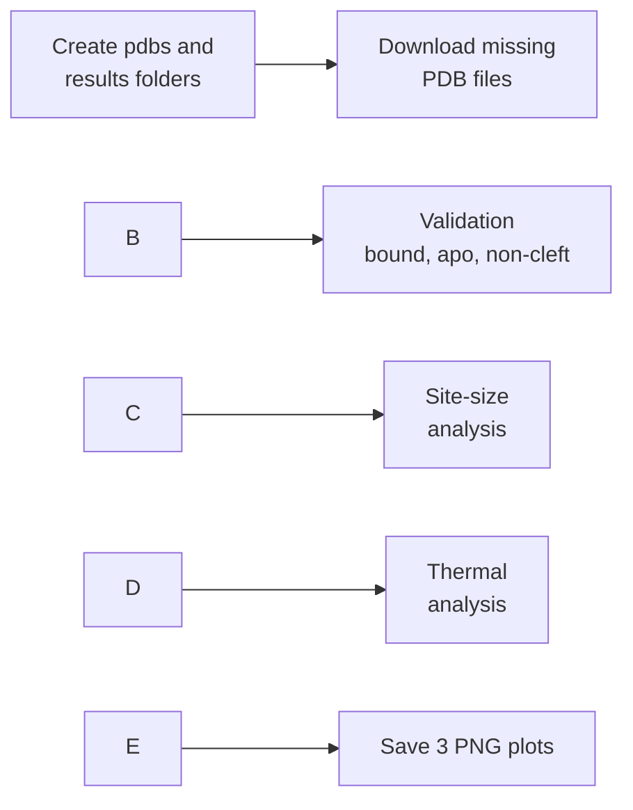
### Run one step at a time
| What you want | Command | Output |
|---|---|---|
| SAFD for one protein, top 10 roughest atoms | python safd.py | printed table |
| Predict pockets for 3DFR | python predict\_pockets.py | clusters and overlap with ligand |
| Benchmark predictions | python benchmark.py | PASS/FAIL table, results/\*\_safd.pdb |
| Bound / Apo / Non-cleft validation | python generate\_validation\_results.py | validation\_results.png |
| Site-size analysis | python site\_size\_analysis.py | site\_size\_result.png |
| Thermal analysis | python thermal\_analysis.py | thermal\_adaptation\_result.png |
| Download benchmark PDBs | python download\_data.py | files in pdbs/ |
| Download extended dataset | python download\_full\_dataset.py | files in pdbs/ |
💡 Scripts that read from pdbs/ need the structures downloaded first. run\_full\_project.py downloads them for you.

### Use it in your own code

```python
from safd import compute_safd

atoms, surface_indices, safd = compute_safd("pdbs/3DFR.pdb")

# safd maps atom index -> roughness value
for idx in surface_indices[:5]:
    atom = atoms[idx]
    print(atom.get_parent().get_resname(), atom.get_name(), round(safd[idx], 2))
```

Settings can be changed:

```python
compute_safd("pdbs/3DFR.pdb", probe_radii=[1.2, 1.4, 1.6, 1.8, 2.1], cutoff=5.0)
```

### Visualize roughness in 3D
benchmark.py writes results/<PDB>\_safd.pdb with each atom's SAFD stored in the **B-factor column**. Any viewer that can color by B-factor will show roughness directly:
| B-factor | Meaning |
|---|---|
| Low | Smoother surface |
| High | Rougher surface |

```text
# PyMOL
load results/3DFR_safd.pdb
spectrum b, blue_white_red
```

---
## 📁 Project structure

Protein-surface-roughness-using-safd/

│

├── safd.py                         # Core: multi-scale SASA to per-atom SAFD

├── sasa.py                         # Shrake–Rupley atomic contact areas

├── run\_full\_project.py             # Main pipeline: download, analyze, plot

│

├── predict\_pockets.py              # High-SAFD atoms + DBSCAN pocket prediction

├── benchmark.py                    # Sensitivity / specificity benchmark

│

├── generate\_validation\_results.py  # Bound / Apo / Non-cleft validation

├── site\_size\_analysis.py           # Small vs large site analysis

├── thermal\_analysis.py             # Thermal adaptation analysis

│

├── download\_data.py                # Download benchmark PDBs

├── download\_full\_dataset.py        # Download extended dataset

│

├── pdbs/                           # Input structures (RCSB)

├── results/                        # SAFD-annotated PDB files

│

├── validation\_results.png

├── site\_size\_result.png

├── thermal\_adaptation\_result.png

└── README.md

---
## ⚠️ Notes and limitations
This is a research prototype and is **not** a validated binding-site predictor.
Results depend on:
- the quality of the PDB structure
- the probe radii and neighborhood cutoff
- the SAFD threshold and DBSCAN settings
- how the binding site is defined (4 Å cutoff, SITE records, partner chain)
- the small size of the datasets (a few structures per group)
Predicted pockets should be confirmed with other structural or biochemical evidence.
### 🚀 Future work
- Larger and more diverse datasets
- Automated functional-site annotation
- Other probe-radius ranges and clustering algorithms
- Comparison with established pocket-detection tools
- Machine-learning models using SAFD as a feature
- Combining SAFD with curvature, electrostatics and conservation
- Interactive 3D visualization or a web interface
---
## 📚 References
- Pettit, F. K. & Bowie, J. U. (1999). Protein surface roughness and small molecular binding sites. *Journal of Molecular Biology*.
- [RCSB Protein Data Bank](https://www.rcsb.org/)
---